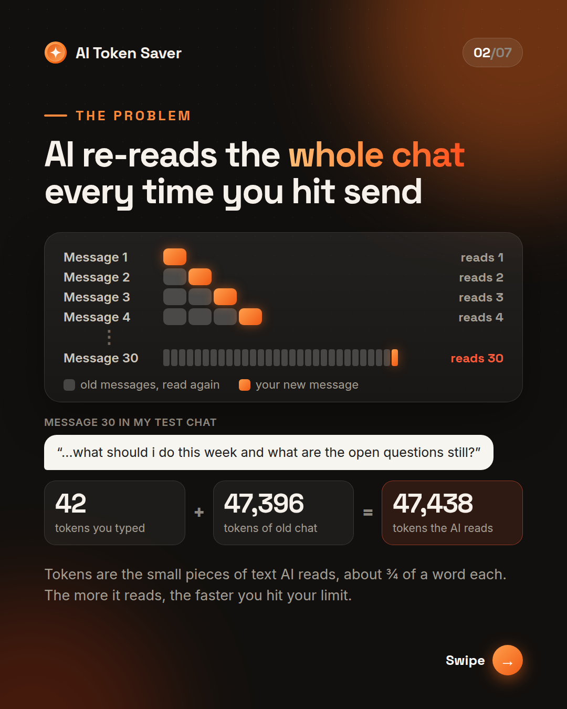
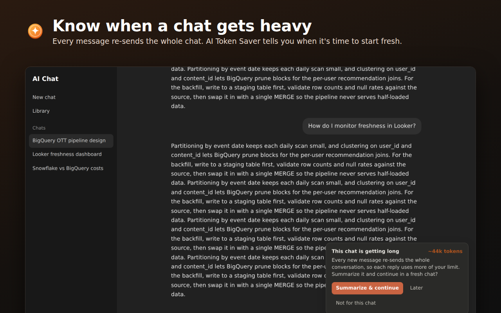
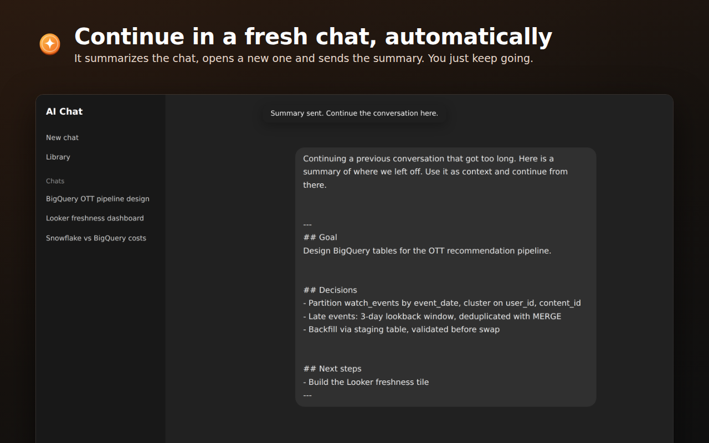
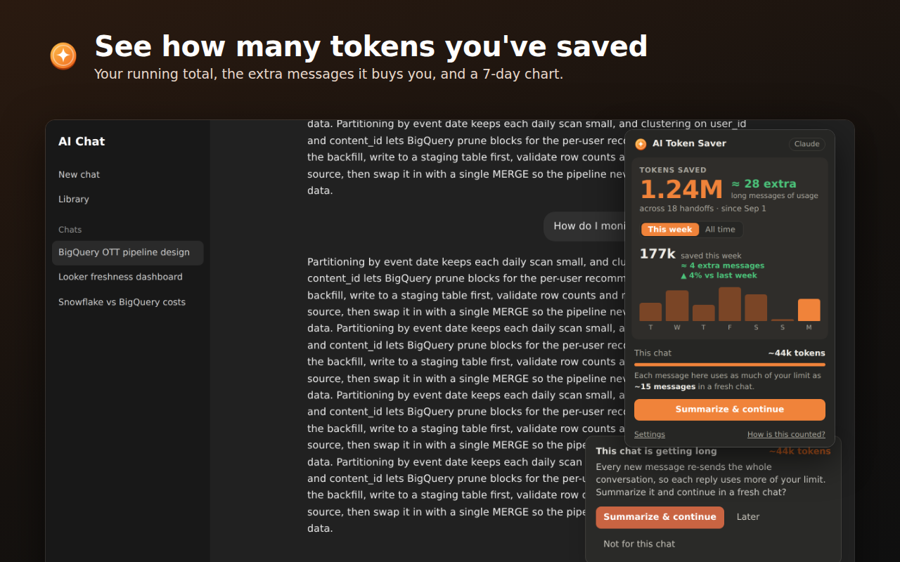

<p align="center"></p>

<h1 align="center">AI Token Saver</h1>

<p align="center">
A Chrome extension that keeps long AI chats cheap. When a chat gets long, it summarizes the conversation and continues it in a fresh chat with one click.<br><br>
<a href="https://chromewebstore.google.com/detail/dgcdcgbeckjfoannaffdjomoabdpjcfe"><b>Install from the Chrome Web Store</b></a>
</p>

---

## The problem

Chat apps re-send the whole conversation with every message. In one 30-message test chat, a 42-token question made the model read **47,438 tokens** to answer it. Long chats burn through usage limits fast.



## What it does

1. Shows an alert when the open chat passes a token threshold (20,000 by default).
2. On **Summarize & continue**, asks the chat for a handoff summary: goal, decisions, key facts, latest code and next steps.
3. Opens a new chat on the same site, pastes the summary (plus anything you had typed) and sends it.
4. Tracks the tokens you've saved, shown as extra messages of usage, or as cost for pay-per-token users.

| Alert on a long chat | Summary sent in a new chat | Tokens-saved popup |
| --- | --- | --- |
|  |  |  |

Supported sites: claude.ai, chatgpt.com, gemini.google.com and perplexity.ai.

## Results

I replayed long chats message by message, with and without handoffs, and counted every token with the GPT-4o (o200k) tokenizer.

| Handoff threshold | Tokens saved on the two long test chats |
| --- | --- |
| **20k (default)** | **36–44%** |
| 30k | 27–30% |
| 40k | 11–14% |

The savings include the cost of writing and sending the summary. The full write-up is in [docs/test-results.pdf](docs/test-results.pdf).

**Limits:** these numbers were calculated by replaying chats, not measured inside each app. Providers also cache chat history, so the effect on a plan's limit may be smaller. Summaries keep what you need to continue, not every detail; long exact code should be pasted again.

## How it works

```
extension/
├── manifest.json        Manifest V3
├── background.js        Opens the welcome page on install
├── src/
│   ├── adapters.js      Per-site selectors: editor, send button, messages, new-chat URL
│   ├── dom.js           Typing into rich-text editors, sending, reading replies as Markdown
│   ├── banner.js        On-page alert and toasts (shadow DOM, isolated from site CSS)
│   ├── content.js       Measures the chat, runs the handoff, pastes into the new chat
│   ├── savings.js       Tokens-saved bookkeeping (local storage only)
│   └── cost.js          Usage / cost formatting
├── popup/               Toolbar popup: tokens saved, weekly chart, current chat size
├── options/             Threshold, auto-send, summary prompt, billing mode
└── welcome/             First-run page
```

The summary moves from the old tab to the new one through `chrome.storage.local`, and is deleted as soon as it's pasted (or after 5 minutes).

### Problems worth mentioning

- **Disappearing messages.** ChatGPT removes old messages from the page as a chat grows, so counting replies never worked. Replies are detected by their content changing and then settling.
- **Different editors on every site.** Text goes in through three fallback methods (`insertText`, a synthetic paste, then direct HTML plus an input event), and each one is checked before moving on.
- **Duplicate script instances.** After an extension update, old content scripts can linger on the page. A leader guard on the document makes sure only one instance shows the alert.
- **Honest savings numbers.** The one-time cost of a handoff (re-reading the chat, the prompt, the summary) is paid back from the first messages before anything is credited, so the total never overstates.

## Run it locally

1. Clone this repo.
2. Open `chrome://extensions`, turn on **Developer mode**, click **Load unpacked** and choose the `extension` folder.

## Tests

```bash
npm install
npm run test:unit   # savings maths and usage/cost formatting
npm run test:e2e    # full handoff in a real Chromium on mock versions of all 4 sites
```

The end-to-end test loads the extension in Chromium with Playwright, serves a mock of each chat site, clicks **Summarize & continue** and checks that the summary was requested, the new chat opened, the draft came along and the saved tokens match the expected value. Set `CHROME_PATH` to use a specific Chromium build.

## Privacy

No servers, no accounts, no analytics. The extension only runs on the four chat sites above, and everything it stores stays in your browser.

## License

[MIT](LICENSE)

AI Token Saver is an independent project and is not affiliated with any AI provider.
